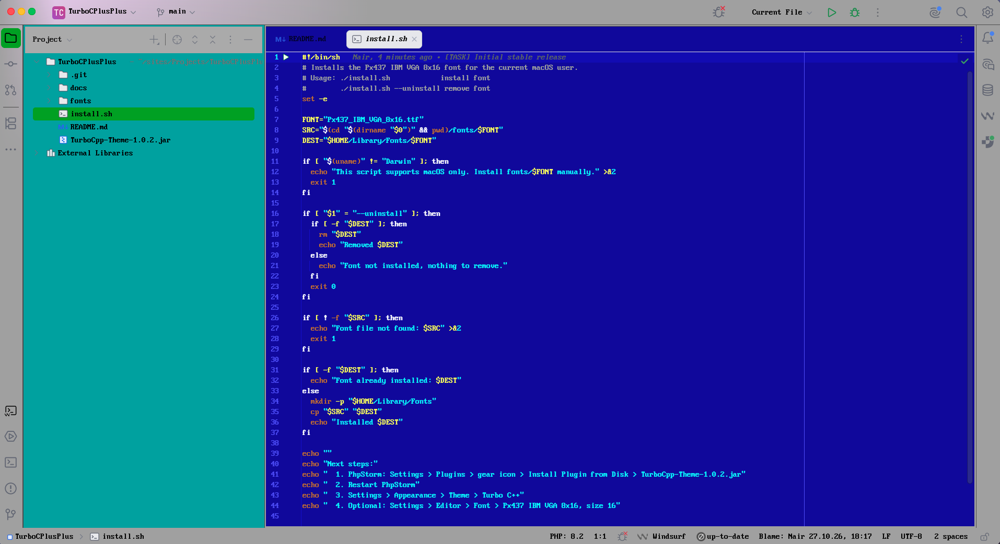

TurboCPlusPlus - AnuBit - Version: 1.0.3 - 10 2026

---

# TurboCPlusPlus for PhpStorm

Retro early-90s DOS IDE look: blue editor with yellow text, light-gray menus and status bar,
green selections, cyan tool windows. Built for the Islands UI (PhpStorm 2026.2+).

## Screenshots



*Editor with shell script, project tree and status bar, using the Px437 IBM VGA 8x16 font.*

## Contents

| File | Purpose |
|---|---|
| `TurboCPlusPlus-1.0.3.jar` | Theme plugin (UI theme + editor color scheme + console colors) |
| `fonts/Px437_IBM_VGA_8x16.ttf` | IBM VGA pixel font |
| `fonts/LICENSE.TXT` | Font license (CC BY-SA 4.0) |
| `install.sh` | Installs the font for the current macOS user |
| `LICENSE` | Theme license (MIT) |

## Installation

1. **Font** (optional, macOS): open Terminal in this folder and run
   ```sh
   ./install.sh
   ```
   Alternatively double-click `fonts/Px437_IBM_VGA_8x16.ttf` and choose *Install* in Font Book.
   Windows/Linux: install the `.ttf` with the system font manager.
2. **Plugin:** PhpStorm → Settings → Plugins → ⚙ → *Install Plugin from Disk…* → `TurboCPlusPlus-1.0.3.jar`.
3. **Restart** PhpStorm.
4. **Theme:** Settings → Appearance & Behavior → Appearance → Theme → *TurboCPlusPlus*.

## Font setup (optional)

The theme does not change fonts. Pick the font yourself:

- **Code:** Settings → Editor → Font → *Px437 IBM VGA 8x16*, size *16*, line height *1.0*, ligatures off.
  Alternative (only while this scheme is active): Editor → Color Scheme → Color Scheme Font →
  tick *Use color scheme font instead of the default* (duplicate the scheme if asked).
- **Terminal/console:** Editor → Color Scheme → Console Font → same settings.
- **UI:** Appearance & Behavior → Appearance → *Use custom font* → *Px437 IBM VGA 8x16*, size 16.

Tips: use size 16 or 32 only, other sizes blur the pixel font. The font covers code page 437;
missing glyphs (emoji, some arrows) fall back to another font.

## Uninstall

- Plugin: Settings → Plugins → Installed → *TurboCPlusPlus* → Uninstall.
- Font: `./install.sh --uninstall` (or remove it in Font Book).

## License

Theme plugin: MIT, see `LICENSE`. The bundled font has its own license (below).

## Credits

Font: *Px437 IBM VGA 8x16* from [The Oldschool PC Font Pack](https://int10h.org/oldschool-pc-fonts/)
by VileR, licensed under CC BY-SA 4.0 (see `fonts/LICENSE.TXT`).

## Release notes

- **1.0.3** – Renamed to TurboCPlusPlus. Plugin icon, MIT license, vendor name updated. Minimum IDE version raised to 2026.2 (tested).
- **1.0.2** – Font setup instructions added to the plugin description.
- **1.0.1** – Fix: theme not listed in the Islands UI.
- **1.0.0** – Initial release: UI theme, editor color scheme, 16-colour console palette.

---

Autor: Anu Bhuvanendran Nair
